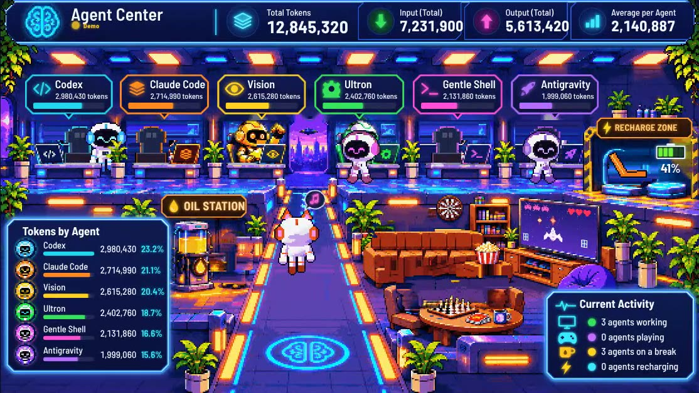

# Agent Center

A pixel-art control centre for AI agents. Each agent is a robot in an office: while it works, it sits at its desk and types; when it is free, it goes off to play chess or UNO, watch TV, have some oil or sleep in the recharge pod. A panel at the top shows how many tokens each agent has used.

**[Interactive demo](https://agents.m2labs.com.ar/)**, with sample numbers rather than real data.



## About this project

I built this by directing AI agents; I don't write code by hand. It was made to fit my own setup, so it is shared as it is, without promises of support. Fork it and adapt it.

## Run it

Needs Python 3.10 or later, with no extra packages.

```bash
python server.py
```

Then open http://127.0.0.1:8088/. The server only listens on your own machine and only accepts reads. The local app and the code comments are in Spanish; the public demo is in English. Opening `prototype/escena/index.html` directly runs the scene in demo mode.

## Adapt it to your agents

The adapters in `src/telemetry/` read the local logs of the agents I use and turn them into one common format. To use your own:

1. Add an adapter in `src/telemetry/` that returns that format. `codex.py` and `claude.py` are good examples.
2. Register it in `SOURCES`, `ORDER` and `NAMES` in `src/telemetry/aggregate.py`.
3. Update the `AGENTS` list and the robot art in `prototype/escena/`.

If a value is missing, the app shows "no data" and marks the total as partial. It never estimates a number to fill the gap. It reads usage figures, not prompts or responses.

To read an agent on a remote server, see `src/telemetry/vision_remote.py`. It connects over SSH with a key, using settings in a local `config.local.json` that is excluded from git.

## Tests

```bash
python -m unittest discover -s tests -v
```

## How the art was made

The scene was rebuilt by code, in layers, from an AI-generated reference image. The reference itself is not included. The robots are generated procedurally from one skeleton.

## Licence

The code is under the MIT licence. The artwork in `prototype/escena/assets/` derives from an AI-generated image and is shared for use with this project; it is not covered by the MIT grant.
